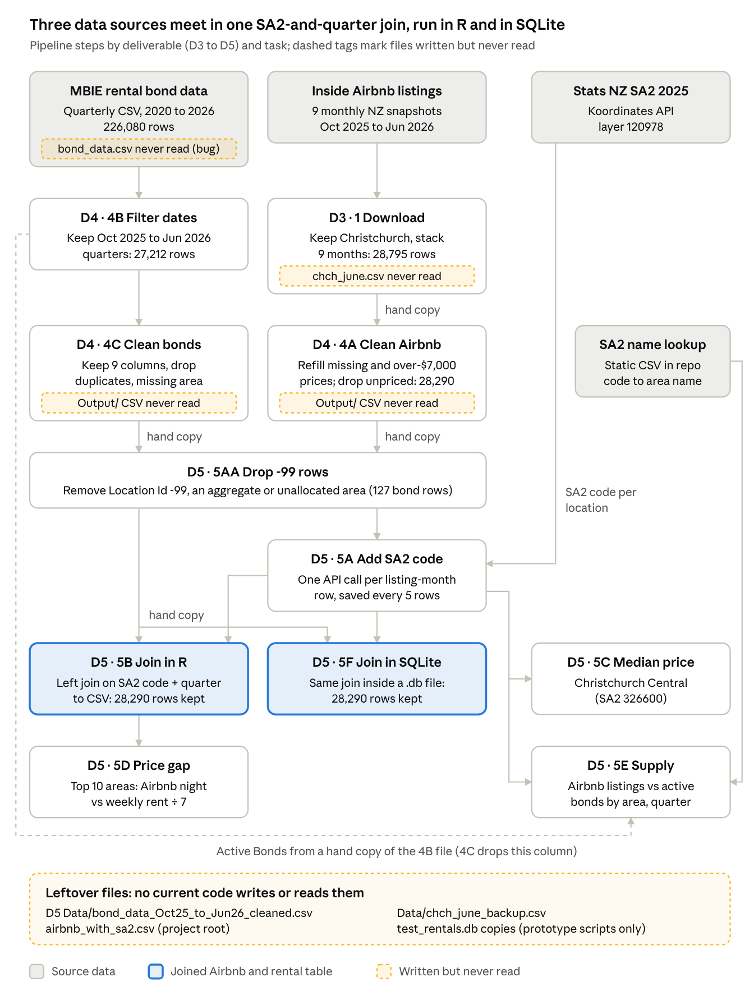

# Pipeline Design Principles

30 September 2026 · Group L4G6

Our R pipeline turns nine monthly Inside Airbnb snapshots (Oct 2025 to Jun 2026) and the MBIE quarterly rental bond file into an area-by-quarter comparison of short-term and long-term rental prices and supply in Christchurch.

This document answers the DATA201/422 brief. It describes the pipeline's (1) inputs, (2) outputs, (3) main steps and (4) coding and software strategies. Section 4 checks our code against the principles in John Bryant's Term 4 lectures (weeks 7–10). It was drafted with Claude Code (Opus 5.5) and checked by two independent AI reviews, summarised in the appendix.

## 1. Inputs

All three inputs are static snapshots, the case the lectures assume.

| Input | Source | Fetched by | Size |
| --- | --- | --- | --- |
| Airbnb listings, 9 monthly snapshots | [Inside Airbnb](https://insideairbnb.com/get-the-data/) | `task_1.R` (`read_csv()` on each month's URL) | 440,050 NZ rows; 28,795 in Christchurch |
| Rental bond data, Q1 2020 to Q3 2026 | [Tenancy Services, MBIE](https://www.tenancy.govt.nz/about-tenancy-services/data-and-statistics/rental-bond-data/) | `main_4.r` (`download.file()`) | 226,080 rows × 12 columns, by SA2 area, quarter, dwelling type and bedrooms |
| SA2 2025 boundaries (layer 120978) | [Stats NZ via Koordinates](https://koordinates.com/from/datafinder.stats.govt.nz/layer/120978-statistical-area-2-2025/) | `task_5A.r`, one API query per listing-month (28,290) | One SA2 code per location: the join key |

A static lookup, `SA2_2025_codes_and_names.csv`, adds area names. D3's Christchurch file is copied into D4's `Data/` folder by hand.

Quirks the code has to handle:

- The bond data marks missing values as `NULL`. A `Location Id` of `-99` is an aggregate or unallocated area.
- `Location Id` should be read as text; only Tasks 4B, 4C, 5E and 5F do this.
- Airbnb `price` is missing for every listing from Dec 2025 to Feb 2026, and for 168–274 listings in each other month (10,667 in total). It is not missing at random.
- Airbnb months are labels (`"Oct 2025"`); bond periods are quarter-start dates (`2025-10-01`).

## 2. Outputs

| Output | Task | Contents |
| --- | --- | --- |
| `airbnb_and_rental_data_Oct25_to_Jun26_cleaned_with_location_id.csv` | 5B | 28,290 listing-months, each with its SA2 code and bond figures (21,566 have a median rent) |
| Console summary | 5C | Median and mean nightly price in Christchurch Central (SA2 326600) |
| `Output/task_5D/median_price_gap_top_10.png` | 5D | Top 10 areas (≥ 10 listings) by gap between Airbnb nightly price and weekly rent ÷ 7 |
| `Output/task_5E/` CSVs and chart | 5E | Airbnb listings vs active bonds by area and quarter; 178 areas, 109–120 of them with a bond count |
| `Output/task_5F/airbnb_and_rental_data_Oct25_to_Jun26_cleaned_with_location_id.db` | 5F | SQLite tables `airbnb`, `rental` and the joined `airbnb_and_rental_data` (same 28,290 and 21,566 as 5B) |

Every step also saves an intermediate CSV; section 3 gives the row counts. Known gaps:

- `property_counts_by_area_quarter.csv` is not in the repository.
- `method_notes.txt` is written by hand, not by the code, and is out of date.

## 3. Main steps

The Airbnb and bond data are cleaned on separate tracks, tagged with a shared SA2 code, then joined by area and quarter. Each deliverable has a `main` script that runs its tasks in order.



1. **D3 Task 1 – Acquire.** Download the 9 Inside Airbnb files, keep Christchurch and stack them (28,795 rows).
2. **D4 Task 4A – Clean Airbnb.** Keep 9 columns. Fill missing prices from the same listing's other months, and treat prices over $7,000 as missing and refill them. Drop the 505 rows still unpriced, leaving 28,290.
3. **D4 Task 4B – Filter bonds.** Keep the quarters from Oct 2025 to Jun 2026 (226,080 → 27,212 rows). **Bug:** 4B and 4C share global path variables. Under `main_4.r`, 4B therefore silently re-reads its own old output instead of the fresh download.
4. **D4 Task 4C – Clean bonds.** Keep 9 typed columns and drop rows with no `Location Id` (27,118 rows).
5. **D5 Task 5AA – Drop `-99`.** Remove 127 bond rows.
6. **D5 Task 5A – Add SA2 codes.** Look up each row's code with the Koordinates API. The lookup can resume after a crash and saves every 5 rows.
7. **D5 Task 5B – Join.** Convert months to quarters and filter bonds to all dwelling types and all bedroom counts. Left join many-to-one on SA2 and quarter, and stop if the row count changes.
8. **D5 Tasks 5C–5E – Analyse.** 5C and 5E read the 5A file, not the join. 5E also reads the 4B file for `Active Bonds`, which 4C drops.
9. **D5 Task 5F – SQLite.** Load the Airbnb and rental CSVs into a database and repeat the 5B join in SQL. Written with Claude Code.

## 4. Coding strategies and lecture principles

Our core strategy is modular R: each task is a function in its own file, called in order by a `main` script, and steps pass data as CSVs. The table checks each lecture principle against the code.

| Principle (lecture) | How we apply it | Gap |
| --- | --- | --- |
| P1 Separate data, code and output (Wk 9 Mon) | D4 and D5 have `Data/`, `Tasks/` and `Output/` folders; raw data is never edited by hand | Files are copied by hand between deliverables; `Output/` is committed to git |
| P2 Project root and relative paths (Wk 9 Mon) | D4 and D5 paths start at the repository root; no `setwd()` | D3 paths start at its own folder; `main.r` runs `install.packages()` on every run |
| P3 Small files, one job each (Wk 7 Tue, Wk 9 Mon) | One task per file, each a function | 4B and 4C pass paths through global variables; `Task_4A.r` runs twice |
| P4 Visible parameters (Wk 9 Mon) | e.g. `price_max_plausible <- 7000`, `batch_size <- 5`, `min_listings <- 10` | 5C hard-codes SA2 `"326600"` |
| P5 Self-documenting code (Wk 9 Mon, Wk 7 Mon) | Descriptive names; explicit column types in 4C | Five tasks let `read_csv()` guess the type of `Location Id` |
| P6 Fail fast and loudly (Wk 9 Mon, Wk 10 Tue) | `stop()` on bad dates (4B), a stale SA2 cache (5A), and duplicate rows or a changed row count (5B, 5F) | D3, 4A and 4C never stop; no `warning()` after imputing prices |
| P7 Sanity checks (Wk 9 Mon) | Row counts logged in D4, 5AA, 5A, 5B and 5F. Check for the tutor: both joins keep all 28,290 rows | No automated report |
| P8 Orchestration (Wk 10 Mon) | One `main` script per deliverable | No single script at the root runs D3 → D5 |
| P9 Configuration file (Wk 10 Tue) | Not adopted | Move the parameters into `config.yaml` |
| P10 Document judgement calls (Wk 8 Mon) | README records the price fill-in and outlier rules; missing bond counts stay `NA` | Prices are filled with our own method, not an established imputation package |
| P11 Human-in-the-loop AI (Wk 7 Tue, Wk 9 Tue) | People design and review; the API key is kept in an environment variable | README doesn't record Codex's use in D5 |
| P12 Continuous integration (Wk 10 Tue) | Not adopted | Add a GitHub Action |
| P13 Coverage and metadata (Wk 8 Tue) | 5E coverage CSVs; D3 summary statistics | No description of the cleaned data |
| P14 Databases for bulk steps (Wk 7 Mon/Tue) | 5F joins the tables in SQLite | 5C–5E still read CSVs; tables are not normalised |

Other strategies:

- **Resumable API calls.** Task 5A saves after every 5 rows, so the 2.5-hour run survives a crash.
- **Git.** The history has 18 pull-request merges, but many commits went straight to `main`.

## 5. Accuracy check using subagents

Tool: Claude Code (```Claude Opus 5.5```) in VS Code, 29 September 2026. <br><br>
I got Claude to check its own work by creating a subagent (with no memory from the original session) and compare ```design_principles.md``` to the code and lecture slides. The findings are in the collapsible sections below; line numbers refer to earlier, longer versions of the document. Both reviews predate Task 5F.

### First review of `design_principles.md` (L4G6, DATA201/422): 6.5 / 10

I read all 8 lecture PDFs, all D3/D4/D5 code, README, D5 Miscellaneous files, every pipeline CSV (counted with `readr`, not `wc -l`), the 5E outputs, and viewed `Plots/pipeline_flow.png` plus the 5D/5E PNGs. No files were modified.

<details>
<summary><b>1. Ratings</b></summary>

**Overall: 6.5/10.** The document is well structured, answers all four parts of the brief, and most lecture attributions and task descriptions are right. But several of its headline numbers are wrong: 29,081 and 446,768 are line counts, not row counts. Some "how we apply it" claims are overstated. It also misses a real orchestration bug in D4 and two manual copy steps.

| Area | Score | Why |
|---|---|---|
| Principles vs slides | 7/10 | All 11 week/day attributions check out. Omits CI, databases/SQL, coverage/metadata, warnings for imputed NAs, and "Output is not committed to git". Two phrases ("API keys", "missing is not zero") are not in the slides. |
| Inputs | 6/10 | Row counts wrong. "Every input is fetched by code" is false. Missing-price and `Location Id` statements are imprecise or overstated. |
| Outputs | 6/10 | D3 counts wrong. `property_counts_by_area_quarter.csv` is not in the repo. `method_notes.txt` is not produced by code and is out of date. The 5AA count is vague. |
| Main steps (text + diagram) | 6/10 | Order is correct. It misses the D3→D4 manual copy and the 4B/4C variable-collision bug. The diagram has a wrong count, a misleading 4A label, a "two sources" title, missing 5E inputs, and alt text saying 9 tasks when there are 10. |
| Coding strategies | 6/10 | Several claims overstated: P1 folders, P5 text typing, P7 "every step", README "every AI use", "one branch and PR per task", "deterministic first". |
| Brief coverage | 9/10 | All four parts answered and prompts included. The lecture-PDF path in the appendix doesn't match the repo. |

</details>

### Andrew's analysis of review #1
The first accuracy review was poor, so I got Claude to alter the ```design_principles.md``` based on the errors found in the first review, and run a second subagent accuracy check

### Second review of design_principles.md (read-only; no files were changed): 8 / 10

I read all 8 lecture PDFs, all the D3–D5 pipeline code, the README, the D5 Miscellaneous notes and the 5E outputs. I counted rows with `readr::read_csv` and checked git history with `git log` / `git ls-files`. I looked at `Plots/pipeline_flow.png`, the 5D and 5E charts and one D3 plot.

<details>
<summary><b>1. Ratings</b></summary>

**Overall: 8 / 10.** Almost every number, file name and threshold is correct. The lecture attributions are right and all four parts of the brief are answered. The one significant error is the description of what the known 4B/4C bug does: it does not "fail on a fresh clone", it silently runs on stale data. The PR count is also wrong for the repository as a whole, and a few claims are slightly understated or overstated.

| Area | Score | Main reason |
|---|---|---|
| Principles vs slides | 8.5 | All 14 attributions check out. A few relevant slide points are missing (see section 3). |
| Inputs | 8.5 | All row counts are correct. Minor wording issues about `""`/`NA`/`-99`, and 5C is missing from the list of tasks that guess the `Location Id` type. |
| Outputs | 8.5 | All counts are correct. The 5C row does not say which file it reads, and prototype or orphan files are not mentioned. |
| Main steps (text + diagram) | 7 | The order and the diagram are correct. What the 4B/4C bug causes is described wrongly (High). The 4A fill step is understated. |
| Coding strategies | 7.5 | "11 PR merges" is wrong for the repo as a whole. P13 overlooks the D3 Task 2 summary statistics. Some small inconsistencies. |
| Brief coverage | 9 | All four parts are covered and the prompts are included. The prompt for this review still needs to be added. |
| Clarity / consistency | 6.5 | About 40% of the document is appendix, including a superseded review table ("6.5/10") that a marker may take as the current score. The principles are listed twice (P-table and §4 table). |

</details>

<details>
<summary><b>2. Errors and questionable claims</b></summary>

| # | Location | Doc says | Actually true | Evidence | Severity |
|---|---|---|---|---|---|
| 1 | §3 step 3 (l.97); repeated in appendix l.186 | 4B "reads its own previous output… and would fail on a fresh clone" | It will not fail. `Output/bond_data_Oct25_to_Jun26.csv` is committed to git, so 4B re-filters that stale file and succeeds. 4B also writes to 4C's output path (`..._cleaned.csv`), which 4C then overwrites. The freshly downloaded `bond_data.csv` is never used, so the error is silent, which goes against "fail loudly". | `main_4.r` l.8–10, 20; `Task_4B.r` l.7–8, 16, 58; `Task_4C.r` l.8–9; `git ls-files` lists `Deliverable 4 - Clean bond data/Output/bond_data_Oct25_to_Jun26.csv` | High |
| 2 | Other strategies, Git bullet (l.128); appendix l.213 | "11 PR merges" | 18 "Merge pull request" commits (#5–#59). 11 is only true if you count D3–D5 (#17, #28–#33, #48, #57–#59). | `git log --merges --grep="Merge pull request"` → 18 | Medium |
| 3 | §3 step 2 (l.96) | Fill missing prices from earlier months; refill over-$7,000 prices from earlier or later months; drop duplicates | The second fill (`downup`) also fills prices that were missing to begin with, from later months. Missing prices go from 1,567 after the first fill to 505. `distinct()` runs before the outlier step and removes 0 rows. | `Task_4A.r` l.45–50, 80–81, 111–120; replicated in R: 1,567 → 505, distinct removed 0 | Medium |
| 4 | P13 gap (l.122) | "no automated description of inputs and cleaned data" | D3 Task 2 automatically writes summary statistics (with `missing_count`) for the raw Christchurch input. Only the cleaned and joined data have none. | `task_2.r` l.13–59 | Low–Med |
| 5 | Inputs quirks (l.54); step 5 (l.99) | Missing values are `""`, `NULL` or `NA`; `-99` = "suppressed or unallocated" | The raw file uses `NULL`. There are no empty fields. `NA` appears as a `Number Of Beds` category. `-99` appears only in `Location Id` (1,091 raw rows, 127 after filtering) as an aggregate or unallocated area with real values. Suppression is shown by `NULL`. | awk over `bond_data.csv`: `-99` only in column 2; `,,` count 0; e.g. `2026-04-01,116700,ALL,NA,6,...` | Low |
| 6 | l.55 and P5 gap (l.114) | 5AA, 5A, 5B, 5D guess the `Location Id` type | 5C also guesses, then uses `as.character()`. For 6-digit codes the numeric read does not change any values, so "keep their exact form" overstates the risk. | `task_5C.r` l.8, 15 | Low |
| 7 | §4 intro (l.106) | "relative paths from the project root" | This is false for D3, as the P2 gap itself says. The two sections contradict each other. | `main.r` l.8–17 | Low |
| 8 | P4 (l.113) | Parameters "named at the top of files" | Most are at the top of the task function (4A, 5A, 5D), not the file. The gap then criticises 5E for keeping its quarters inside the function. | `Task_4A.r` l.13–16; `task_5A.r` l.9–10; `task_5E.r` l.26 | Low |
| 9 | Outputs 5C row (l.68) | Median and mean for SA2 326600 | This is correct, but 5C reads the 5A file, not the 5B join, and keeps one row per listing (its first month). | `task_5C.r` l.8, 23–24 | Low |
| 10 | P6 (l.115) | List of `stop()` checks | The list is incomplete: 4B (required columns), 5A (missing API key), 5C and 5D (empty results) also stop. | code lines 31–34, 32, 25, 26 | Low |
| 11 | Git bullet (l.128) | R session files are in `.gitignore` | `.RDataTmp` and `.RDataTmp1` are tracked. | `git ls-files` | Low |
| 12 | Outputs l.85 / P14 | 5F "planned but not built" | Correct for the pipeline, but a prototype `test_rentals.db` (tables `airbnb_data`, `rental_house_data`) and `Miscellaneous/db_query_example.r` (`SELECT *`, and a path with a double space) exist. | `sqlite3 -readonly test_rentals.db .tables` | Low |
| 13 | Appendix l.175–186 | "Overall accuracy: 6.5 / 10" and its table | This rates the earlier draft, but it reads like the current score. | — | Low (clarity) |
| 14 | Appendix l.220 | "No code or git history was changed" | This is true for code. However, `README.md` has uncommitted edits (+64/−55, mostly formatting); I could not tell who made them. | `git diff --stat` | Low / unverified |

</details>

<details>
<summary><b>3. Omissions</b></summary>

**From the slides:**
- **Wk 10 Tue, "Handling errors":** after imputing, keep testing for NAs in the columns you are not imputing, and raise a `warning()`. This applies directly to the 4A price fill. The earlier review flagged it too, but it was never added.
- **Wk 8 Mon, slide 17:** "don't implement your own special method" for missing values; use packages and look for Missing-at-Random groups. Our hand-made last/next-value fill of the Dec–Feb prices (100% missing, which the doc itself says is not missing at random) goes against this. P10 should say so.
- **Wk 7 Tue, modularity:** "information passed between components in clear, explicit way". The 4B/4C global-variable bug breaks exactly this rule; P3 should cite it.
- **Wk 9 Mon ("comments lie") and Wk 8 Tue ("incorrect metadata is worse than no metadata"):** these apply to the stale `method_notes.txt` ("top 20" when the chart shows 10).
- **Wk 8 Tue coverage ideas** (target population vs sample, selection bias): Inside Airbnb scrapes vs bonded tenancies only.
- **Wk 10 Mon:** automated reports (Quarto) and Makefiles, beyond the passing mention "No automated report yet".
- Smaller points:
  - Wk 9 Mon "one file, one output".
  - Wk 7 Tue "maintain a natural-language description" (this document is an example of it).
  - Wk 7 Tue normalisation (relevant to 5F).
  - Wk 8 Mon entity resolution: matching listings by `id` across months, and the SA2 lookup.

**Pipeline facts:**
- D3 `main.r` sources `task_2.R`–`task_5.R` but the files are named `.r`, so it only works on case-insensitive file systems. It also calls `install.packages("tidyverse")` on every run.
- D3 Task 3 downloads the June NZ listings URL a second time.
- `main_4.r` downloads the bond file on every run, and that download is never actually used (see error #1).
- Orphan files not produced by the current code:
  - D5 `Data/bond_data_Oct25_to_Jun26_cleaned.csv`
  - D5 `Data/rental_data_Oct25_to_Jun26_cleaned_with_location_id.csv` (identical to the 5AA rental output)
  - root `airbnb_with_sa2.csv` (9 rows)
  - root `test_rentals.db`
  - `Data/chch_june_backup.csv`
- The "main" scripts for D4 and D5 live in `Tasks/`, not in the project root as the Wk 10 Mon slides describe.
- The appendix does not yet contain the prompt for this review or its results.

</details>

<details>
<summary><b>4. Proposed changes (approve or reject each one)</b></summary>

1. **l.97** — Current: "Because `main_4.r` sources 4C before calling `task_4B()`, 4B currently reads its own previous output instead of `bond_data.csv` and would fail on a fresh clone. Move the paths inside each function."
   → Replace with: "Because `main_4.r` sources 4C before calling `task_4B()`, 4B reads its own previous output (`Output/bond_data_Oct25_to_Jun26.csv`, which is committed to git) instead of the freshly downloaded `bond_data.csv`, and writes to 4C's output path, which 4C then overwrites. The run therefore succeeds silently on stale data instead of failing. Move the paths inside each function."
2. **l.186** — Current: "On a fresh clone it would fail."
   → Replace with: "On a fresh clone it would fail. (Corrected by the Prompt 5 review: that output file is committed to git, so the run does not fail; it silently reuses stale data.)"
3. **l.128** — Current: "(11 PR merges)"
   → Replace with: "(18 pull-request merges in the history, 11 of them for Deliverables 3–5)"
4. **l.213** — Current: "and 11 PR merges."
   → Replace with: "and 11 PR merges (Deliverables 3–5 only; 18 in the full history)."
5. **l.96** — Current: "fill missing prices from earlier months of the same listing; treat prices over $7,000 as errors and refill them from earlier or later months; drop exact duplicates and rows still without a price (505 rows, leaving 28,290)"
   → Replace with: "fill missing prices from earlier months of the same listing; drop exact duplicates (none found); treat prices over $7,000 as missing, then fill every remaining gap from earlier or later months of the same listing; drop rows still without a price (505 rows, leaving 28,290)"
6. **l.122** — Current: "no automated description of inputs and cleaned data."
   → Replace with: "D3 Task 2 writes summary statistics (including missing counts) for the raw Christchurch input, but there is no automated description of the cleaned or joined data."
7. **l.54** — Current: "- Bond data marks missing values as `""`, `NULL` or `NA`, and uses `-99` for suppressed or unallocated areas."
   → Replace with: "- Bond data marks missing values as `NULL` (the code also treats `""` and `NA` as missing, although `NA` also appears as a `Number Of Beds` category), and uses `Location Id` `-99` for an aggregate or unallocated area."
8. **l.99** — Current: "(suppressed or unallocated area)"
   → Replace with: "(aggregate or unallocated area; `-99` only appears in `Location Id`)"
9. **l.55** — Current: "Tasks 5AA, 5A, 5B and 5D still let `read_csv()` guess, which reads it as a number."
   → Replace with: "Tasks 5AA, 5A, 5B, 5C and 5D still let `read_csv()` guess, which reads it as a number (5C then converts it back to text)."
   Make the same change at l.114: "Tasks 5AA, 5A, 5B and 5D" → "Tasks 5AA, 5A, 5B, 5C and 5D".
10. **l.106** — Current: "reading and writing CSVs at relative paths from the project root."
    → Replace with: "reading and writing CSVs at relative paths (from the project root in D4 and D5; from its own folder in D3)."
11. **l.113** — Current: "Named at the top of files:"
    → Replace with: "Named at the top of each file or task function:"
12. **l.115 (P6 gap)** — Current: "D3, 4A and 4C print checks but do not stop on them."
    → Replace with: "D3, 4A and 4C print checks but do not stop on them. 4A imputes prices without raising a `warning()` or testing for NAs in columns it does not impute (Wk 10 Tue)."
13. **l.112 (P3 gap)** — Current: "`Task_4A.r` calls `task_4A()` when sourced, so `main_4.r` runs it twice."
    → Append: " 4B and 4C pass file paths through shared global variables instead of explicit function arguments (Wk 7 Tue: pass information between components in a clear, explicit way)."
14. **l.119 (P10 gap)** — Current: "Confirm that bond SA2 codes use the 2025 boundaries."
    → Replace with: "Our price fill-in is a hand-made nearest-month method for data that is not missing at random; the Wk 8 Mon slides advise using an established imputation package, so treat the Dec–Feb prices with caution. Confirm that bond SA2 codes use the 2025 boundaries."
15. **l.34** — Current: "| Wk 8, enriching data |"
    → Replace with: "| Wk 8 Mon, enriching data |"
16. **l.68** — Current: "Median and mean nightly Airbnb price for Christchurch Central (SA2 326600)"
    → Replace with: "Median and mean nightly Airbnb price for Christchurch Central (SA2 326600), one row per listing, read from the Task 5A file (not the 5B join)"
17. **l.85** — Current: "Planned but not built: Task 5F, storing the joined tables in a SQLite database."
    → Replace with: "Planned but not built: Task 5F, storing the joined tables in a SQLite database (a prototype `test_rentals.db` and `Miscellaneous/db_query_example.r` exist but are not part of the pipeline)."
18. **l.111 (P2 gap)** — Current: "D3 `main.r` uses paths relative to its own folder."
    → Replace with: "D3 `main.r` uses paths relative to its own folder, sources `task_2.R`–`task_5.R` although the files are named `.r` (works only on case-insensitive file systems), and calls `install.packages()` on every run."
19. **l.128** — Current: "the virtual environment, `.env` and R session files are in `.gitignore`."
    → Replace with: "the virtual environment, `.env` and R session files are in `.gitignore` (although `.RDataTmp` and `.RDataTmp1` are still tracked)."
20. **l.175** — Current: "**Overall accuracy: 6.5 / 10.**"
    → Replace with: "**Overall accuracy of the earlier draft: 6.5 / 10.**"
21. **Appendix** — Add "Prompt 5" (the prompt for this review, verbatim) and a short "Results of Prompt 5" (score 8/10 plus the changes that were accepted). Also consider shortening the superseded Prompt 3 results table to make the document easier for a marker to read.

</details>

<details>
<summary><b>5. Claims verified as correct</b></summary>

- **D3 row counts:** 28,795 Christchurch / 440,050 NZ / 3,469 `chch_june.csv`. `wc -l` gives 29,081 / 446,768 data rows, which confirms the earlier review's explanation of the old wrong numbers.
- **D3 → D4 copy:** D4 `Data/airbnb_chch_Oct25_to_Jun26.csv` is byte-identical to the D3 file (hand copy).
- **Bond file:** 226,080 rows × 12 columns.
- **Bond filtering and cleaning:**
  - 4B: 226,080 → 27,212 rows.
  - 4C: 27,212 → 27,118 (0 duplicates, 94 rows with no `Location Id`); 9 typed columns; drops Active Bonds.
  - 5AA: 127 bond rows removed → 26,991; 0 Airbnb rows removed.
- **Airbnb prices:**
  - Missing for 100% of the Dec/Jan/Feb snapshots (3,180 / 3,057 / 3,190 rows), 168–274 in each other month, 10,667 in total.
  - 505 rows dropped → 28,290; maximum remaining price $6,277; the four ~$43k listings are removed.
- **SA2 and join:**
  - 5A: 28,290 rows, 0 missing SA2 codes, 178 distinct SA2s.
  - 5B: 28,290 joined rows, 21,566 with a median rent; many-to-one join with a row-count `stop()`.
- **5E:**
  - Coverage 178 areas per quarter; 109/120/115 with a bond count; 69+58+63 = 190 area-quarters without one.
  - `property_counts_by_area_quarter.csv` is absent (deleted in commit 75f0c09).
  - `method_notes.txt` is not written by the code (not in the current or original 5E) and says "top 20" while the chart shows 10.
  - Reads the D4 `Data/` copy of the 4B file and removes `-99` itself.
- **5D:** at least 10 listings, top 10, gap = price − median rent ÷ 7.
- **Structure and conventions:**
  - `Task_4A.r` calls `task_4A()` at l.161.
  - No `setwd()`, no config file, no `.github/`.
  - The API key comes from an environment variable.
  - The README does not mention Codex for D5; `D6_code_review_notes.md` does.
- **Diagram:** every box, count and arrow matches the code, including 5C from 5A and the dashed 4B → 5E line.
- **Lecture attributions:** all 14 match the slides:
  - Wk 7 Mon: `SELECT *`, `ORDER BY`, database for deterministic bulk steps.
  - Wk 7 Tue: modularity, check unique rows, sensitive data.
  - Wk 8 Mon: documenting judgement calls, deterministic early / modelling late.
  - Wk 8 Tue: coverage, metadata, data descriptions.
  - Wk 9 Mon: folders, paths, small files, parameters, self-documenting code, assertions, sanity checks.
  - Wk 9 Tue: human-in-the-loop.
  - Wk 10 Mon: orchestration.
  - Wk 10 Tue: configuration files, fail fast, continuous integration.
- **Earlier review's 14 changes:** all were applied as the appendix says.

**Could not verify:** that the prompts are verbatim, "in VS Code", "project board", the 2.5-hour API run time (only the README says so), "most tasks built on their own branch", and who made the uncommitted README edits.

</details>

## 6. Andrew's conclusions
### Which design principles did we ask Claude to identify?
I asked Claude to compare our code against the design principles in the lecture slides from term four because I remembered term three being more about general data wrangling principles; perhaps I should have included term three lecture slides as well?

### Claude's correct analysis
(As best I can) I've checked the code against what Claude says it does. Claude seems to have done a good job of reading and 'understanding' our code, and it's useful to see the flowchart showing how our pipeline is operating...and where it is operating poorly.

Some of the mistakes evident in Claude's ```design_principles``` document were due to us wanting to keep the code contained within the deliverable - for the sake of tidyness and simplicity. For example: <br>
- ```airbnb_chch_Oct25_to_Jun26_cleaned.csv``` was produced as an output for deliverable 4, but deliverable 5 opens a copy made by hand to ```deliverable 5/Data``` instead of opening it from ```deliverable 4/output``` 

However I think other mistakes were due to poorly written task information on the project/Trello board. 

We assigned tasks quite quickly and copy/pasted information into each task brief straight from the deliverable brief. We really needed someone to take a few hours to read through the brief and understand it more deeply so that they could write more detailed pseudocode for each task, specifically noting the input and output files.

E.g 
- I remember in deliverable 5(?), code from one member duplicating a process that had already been done by another member. This could have been avoided with better instructions and psuedocode.
- Claude notes that '5C and 5E read the 5A file, not the join. 5E also reads the 4B file for Active Bonds, which 4C drops.'

### Claude's incorrect analysis
1. Claude seems to have made a mistake when it says that ```chch_june.csv``` was hand-copied to deliverable four; I can't see any evidence of that happening.<br>
Claude has explained that the flowchart wasn't clear enough about what actually happened here: "```chch_Oct25_to_Jun26.csv``` was copied into ```Deliverable 4 - Clean bond data/Data/``` and renamed ```airbnb_chch_Oct25_to_Jun26.csv```. The two files are byte-for-byte identical."<br>
2. Claude doesn't seem to have identified that we haven't used the design principle that the function and output name should match and describe what the function does. <br>
  E.g. ```chch_median_prices()``` should produce ```chch_median_prices.csv```. <br>
  However, I can't find anywhere in the lecture slides that this principle is explained...maybe it was only explained verbally during the lecture?

### Other improvements we can make from Claude's analysis of the code
- Many commits went straight to ```main```. We're still building that habit and we'll improve over time

### Other improvements we can make from our own analysis of the code
- Code is often bloated due to use of Gen-AI which tries to 'do everything'
- Code is sometimes difficult for someone else to critique because of Gen-AI bloat, and lack of comments
- I suspect we're not acknowledging the use of Gen-AI as often as we should

